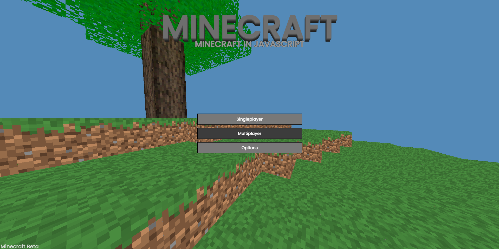
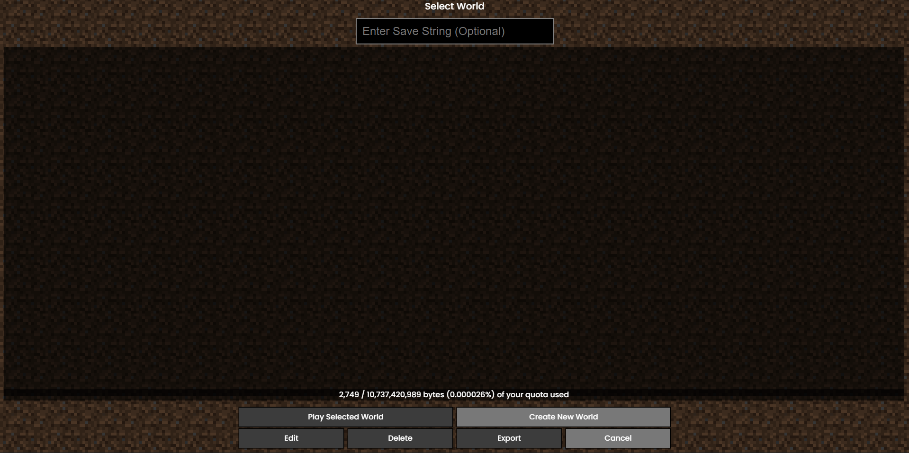
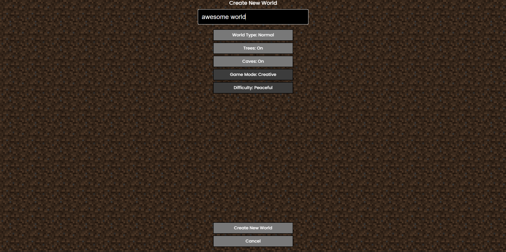
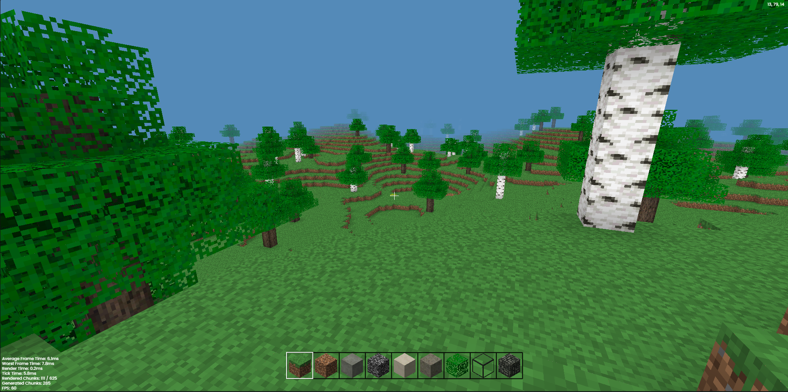

# Minecraft-in-html

**Live demo:** https://chandrasen74.github.io/Minecraft-in-html/  
**Repository:** https://github.com/Chandrasen74/Minecraft-in-html

## Screenshots





## Overview
`Minecraft-in-html` is a Minecraft-inspired voxel sandbox running in the browser (HTML/CSS/JS).
- **Primary language:** HTML
- **Languages detected:** HTML
- **Stack/tech:** HTML, CSS, JavaScript (single-file game logic)
- **Entry point:** `index.html` (redirects to `JScarft.html`)
- **Key files:** `index.html`, `JScarft.html`, `controls.txt`

Updated to Minecraft version 2.

## Language & stack details
- Languages: HTML
- Frameworks/tools/libraries: HTML

## How to install & run
### Prerequisites
- A modern web browser
- (Optional) [Python 3](https://www.python.org/) or any static file server for local serving

### Run locally
```bash
git clone https://github.com/Chandrasen74/Minecraft-in-html.git
cd Minecraft-in-html
```
- **Option 1:** open `index.html` directly in your browser
- **Option 2:** serve locally (recommended for some JS features):
```bash
python -m http.server 8000
# then open http://localhost:8000
```

## Repository structure (top-level/sample)
- `.nojekyll`
- `JScarft.html`
- `README.md`
- `controls.txt`
- `index.html`
- `screenshot.png`
- `screenshot-1.png`
- `screenshot-2.png`
- `screenshot-3.png`
- `screenshot-4.png`

## Status
Documented with screenshot, language/stack details, and setup instructions as part of a profile-wide README update.

## License

Copyright (c) 2026 Chandrasen. All rights reserved.

This repository is proprietary. No permission is granted to use, copy, modify, or distribute this code without prior written permission.
See [LICENSE](LICENSE).
